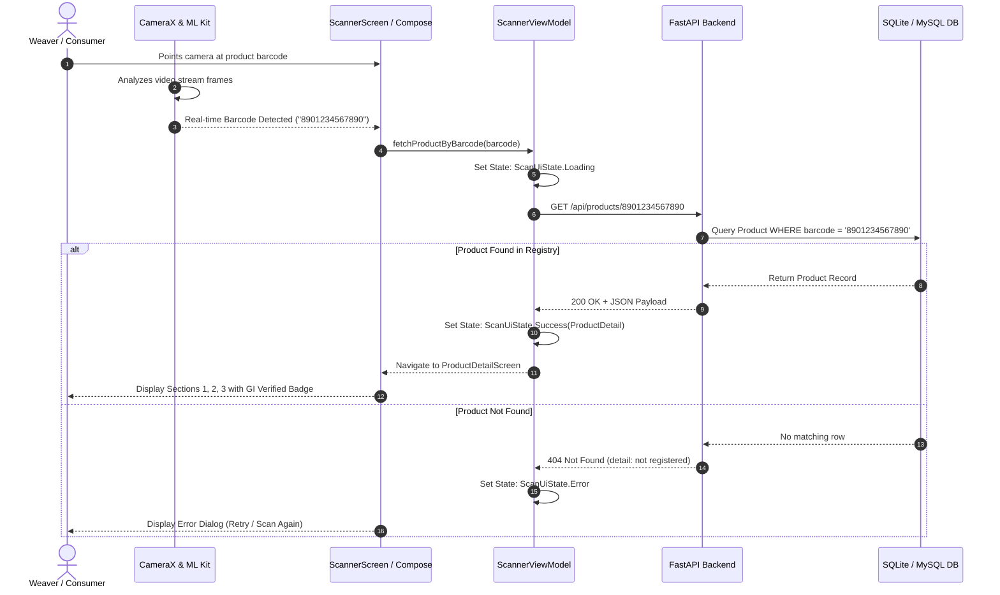

# Software Architecture Document (SAD)
## Craft & GI Product Verification System

---

## 1. System Overview

The **Craft & GI Product Verification System** is a distributed mobile and cloud architecture designed to verify and authenticate Geographical Indication (GI) handloom textiles and craft products using real-time barcode scanning.

### Core Architectural Pillars
- **Real-Time Edge Computer Vision**: CameraX + Google ML Kit on-device barcode parsing.
- **Microservices-Ready REST API**: High-throughput asynchronous FastAPI backend.
- **Dual-Engine Persistence Strategy**: Zero-configuration SQLite for localized sandboxing & rapid testing, with a one-flag switch to production MySQL with connection pooling.
- **Domain-Structured UI**: Strict partition into 3 core domain sections (Fabric & Yarn, Design & Physical Specs, GI & Artisan Traceability).

---

## 2. High-Level Architecture Diagram

```mermaid
flowchart TD
    subgraph MobileDevice["Android Client (Kotlin + Jetpack Compose)"]
        UI["Compose UI Screens\n(ScannerScreen / ProductDetailScreen)"]
        VM["ScannerViewModel\n(StateFlow / Coroutines)"]
        Camera["CameraX + ML Kit\n(Barcode Analyzer)"]
        Network["Retrofit 2 + Moshi\n(HTTP Client)"]
        
        Camera -->|Raw Barcode| UI
        UI -->|Event| VM
        VM -->|Query| Network
    end

    subgraph BackendAPI["Backend Service (FastAPI)"]
        Router["FastAPI Router\n(/api/products)"]
        Schemas["Pydantic Schemas\n(Validation & Serialization)"]
        CRUD["SQLAlchemy 2.0 ORM\n(Data Access Layer)"]
        
        Network -->|HTTP GET /api/products/{barcode}| Router
        Router --> Schemas
        Router --> CRUD
    end

    subgraph DataStorage["Data Persistence"]
        SQLite[("Local SQLite Engine\n(craft_products.db)")]
        MySQL[("Production MySQL Cluster\n(DATABASE_URL)")]
        
        CRUD -->|Local Dev| SQLite
        CRUD -->|Production| MySQL
    end
```

---

## 3. End-to-End Scanning & Verification Sequence



---

## 4. Mobile Architecture (Android)

The Android application is built using the **MVVM (Model-View-ViewModel)** architectural pattern adhering to Android Modern Architecture guidelines:

### A. Presentation Layer (`ui`)
- **Jetpack Compose**: Declarative UI rendered using Material Design 3.
- **Theme Engine**: Heritage-inspired craft color palette (Terracotta `#C04000`, Gold Accent `#D4AF37`, Forest Green `#1B5E20`).
- **Reactive State Flow**: UI observes `ScannerViewModel.uiState` modeled as a sealed class:
  ```kotlin
  sealed class ScanUiState {
      object Idle : ScanUiState()
      data class Loading(val barcode: String) : ScanUiState()
      data class Success(val product: ProductDetail) : ScanUiState()
      data class Error(val barcode: String, val message: String) : ScanUiState()
  }
  ```

### B. Vision & Analyzer Layer (`ui/components`)
- **CameraX + PreviewView**: Manages lifecycle-aware hardware camera binding.
- **Google ML Kit Barcode Analyzer**: Runs on a background single-thread executor with `STRATEGY_KEEP_ONLY_LATEST` backpressure to guarantee low latency without blocking UI frames.

### C. Data & Network Layer (`data`)
- **Retrofit 2**: REST API consumer.
- **Moshi Kotlin**: Reflection-less / generated type adapter JSON serialization.
- **Dynamic Network Configuration**: Enables on-the-fly switching between Android Emulator loopback (`10.0.2.2:8000`), local Wi-Fi router IP (`192.168.x.x:8000`), and production domains.

---

## 5. Backend Architecture (FastAPI)

### A. Layered Architecture
1. **Routing (`app/main.py`)**: Request handling, HTTP error status mapping, CORS middleware.
2. **Business Logic & Persistence (`app/crud.py`)**: Clean query encapsulation separating database interaction from HTTP concerns.
3. **Data Integrity & Validation (`app/schemas.py`)**: Pydantic models ensuring strict schema enforcement and OpenAPI metadata generation.
4. **Relational Models (`app/models.py`)**: SQLAlchemy declarative models with indexed lookup fields.

### B. Database Dual-Engine Switch
Controlled through `DATABASE_URL`:
- If starts with `sqlite`: Injects `check_same_thread: False`.
- If MySQL or PostgreSQL: Enables standard connection pooling (`pool_pre_ping=True`).
