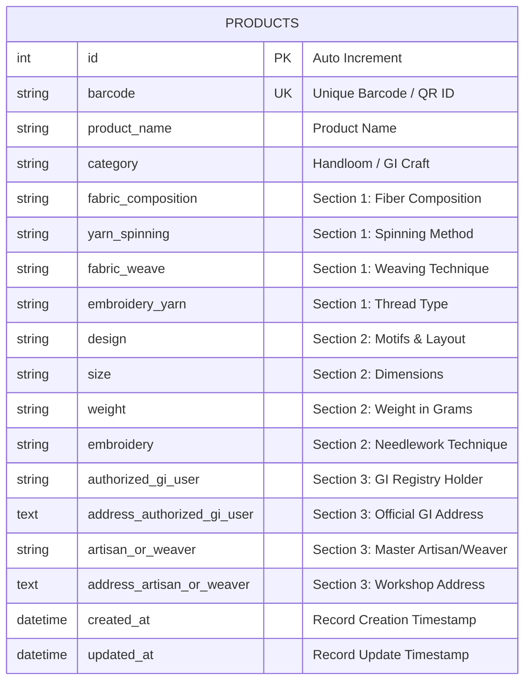

# Database Schema & Data Dictionary
## Craft & GI Product Verification System

---

## 1. Entity-Relationship Diagram (ERD)



---

## 2. Comprehensive Data Dictionary

### Product Identification
| Column | Type | Constraints | Description |
|---|---|---|---|
| `id` | `INTEGER` | Primary Key, Auto-increment | Unique system identifier |
| `barcode` | `VARCHAR(100)` | Unique, Indexed, Non-null | Scanned barcode number / EAN-13 / Code-128 / QR |
| `product_name` | `VARCHAR(255)` | Non-null | Name of craft / product |
| `category` | `VARCHAR(100)` | Nullable | Craft category classification |

### Section 1: Fabric & Yarn Specifications
| Column | Type | Nullable | Example Value |
|---|---|---|---|
| `fabric_composition` | `VARCHAR(255)` | `NOT NULL` | 100% Pure Changthangi Pashmina Wool |
| `yarn_spinning` | `VARCHAR(255)` | `NOT NULL` | Hand Spun (Traditional Charkha / Yinder) |
| `fabric_weave` | `VARCHAR(255)` | `NOT NULL` | Handloom Diamond Weave (Chashm-e-Bulbul) |
| `embroidery_yarn` | `VARCHAR(255)` | `NOT NULL` | Pure Mulberry Silk Thread |

### Section 2: Product Specifications
| Column | Type | Nullable | Example Value |
|---|---|---|---|
| `design` | `VARCHAR(255)` | `NOT NULL` | Paisley (Kalka motif) with Hashiya border |
| `size` | `VARCHAR(100)` | `NOT NULL` | 200 cm x 70 cm (Stole) |
| `weight` | `VARCHAR(100)` | `NOT NULL` | 145 grams |
| `embroidery` | `VARCHAR(255)` | `NOT NULL` | Sozni Needlework |

### Section 3: GI Registry & Artisan Traceability
| Column | Type | Nullable | Example Value |
|---|---|---|---|
| `authorized_gi_user` | `VARCHAR(255)` | `NOT NULL` | Craft Development Institute / GI-KASH-PASH-042 |
| `address_authorized_gi_user`| `TEXT` | `NOT NULL` | Noorbagh Industrial Complex, Srinagar |
| `artisan_or_weaver` | `VARCHAR(255)` | `NOT NULL` | Master Ghulam Mohammad Mir |
| `address_artisan_or_weaver` | `TEXT` | `NOT NULL` | Mir Mohalla, Zadibal, Srinagar |

### Audit Metadata
| Column | Type | Nullable | Description |
|---|---|---|---|
| `created_at` | `DATETIME` | `NULLABLE` | Timestamp of registration (UTC) |
| `updated_at` | `DATETIME` | `NULLABLE` | Timestamp of last modification (UTC) |

---

## 3. SQL DDL Statements

### MySQL (Production)
```sql
CREATE TABLE IF NOT EXISTS products (
    id INT AUTO_INCREMENT PRIMARY KEY,
    barcode VARCHAR(100) NOT NULL UNIQUE,
    product_name VARCHAR(255) NOT NULL,
    category VARCHAR(100) DEFAULT 'Handloom / GI Craft',
    fabric_composition VARCHAR(255) NOT NULL,
    yarn_spinning VARCHAR(255) NOT NULL,
    fabric_weave VARCHAR(255) NOT NULL,
    embroidery_yarn VARCHAR(255) NOT NULL,
    design VARCHAR(255) NOT NULL,
    size VARCHAR(100) NOT NULL,
    weight VARCHAR(100) NOT NULL,
    embroidery VARCHAR(255) NOT NULL,
    authorized_gi_user VARCHAR(255) NOT NULL,
    address_authorized_gi_user TEXT NOT NULL,
    artisan_or_weaver VARCHAR(255) NOT NULL,
    address_artisan_or_weaver TEXT NOT NULL,
    created_at DATETIME DEFAULT CURRENT_TIMESTAMP,
    updated_at DATETIME DEFAULT CURRENT_TIMESTAMP ON UPDATE CURRENT_TIMESTAMP,
    INDEX idx_products_barcode (barcode)
) ENGINE=InnoDB DEFAULT CHARSET=utf8mb4 COLLATE=utf8mb4_unicode_ci;
```

### SQLite (Local Development)
```sql
CREATE TABLE IF NOT EXISTS products (
    id INTEGER PRIMARY KEY AUTOINCREMENT,
    barcode VARCHAR(100) NOT NULL UNIQUE,
    product_name VARCHAR(255) NOT NULL,
    category VARCHAR(100) DEFAULT 'Handloom / GI Craft',
    fabric_composition VARCHAR(255) NOT NULL,
    yarn_spinning VARCHAR(255) NOT NULL,
    fabric_weave VARCHAR(255) NOT NULL,
    embroidery_yarn VARCHAR(255) NOT NULL,
    design VARCHAR(255) NOT NULL,
    size VARCHAR(100) NOT NULL,
    weight VARCHAR(100) NOT NULL,
    embroidery VARCHAR(255) NOT NULL,
    authorized_gi_user VARCHAR(255) NOT NULL,
    address_authorized_gi_user TEXT NOT NULL,
    artisan_or_weaver VARCHAR(255) NOT NULL,
    address_artisan_or_weaver TEXT NOT NULL,
    created_at TIMESTAMP DEFAULT CURRENT_TIMESTAMP,
    updated_at TIMESTAMP DEFAULT CURRENT_TIMESTAMP
);
CREATE UNIQUE INDEX IF NOT EXISTS ix_products_barcode ON products (barcode);
```
